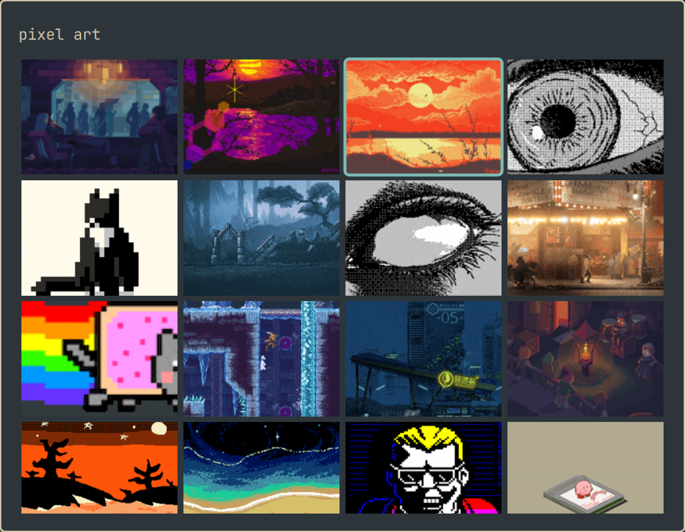

# omarchy-giphy

A dead simple GIF picker for [Omarchy](https://omarchy.org). Search Giphy, press Enter, and the GIF is inserted into the focused window. Your clipboard is left as it was.



## Install

```bash
omarchy plugin add https://github.com/jamers99/omarchy-giphy --enable
```

Add a shortcut to `~/.config/hypr/bindings.lua`:

```lua
o.bind("SUPER + CTRL + G", "GIFs", "omarchy-shell shell toggle io.github.jamers99.omarchy-giphy")
```

Open it with Super+Ctrl+G. The first time, it shows how to get a free Giphy API key.

Needs `curl`, `wl-clipboard` and `wtype`, which Omarchy includes.

## Remove

```bash
omarchy plugin remove io.github.jamers99.omarchy-giphy
rm -rf ~/.config/omarchy/giphy-key ~/.cache/giphy
```

Then delete the shortcut line from `~/.config/hypr/bindings.lua`.
